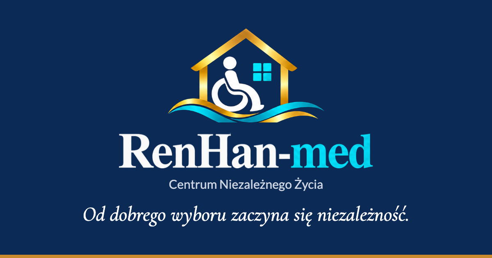

# RenHan-med




Strona internetowa RenHan-med — Centrum Niezależnego Życia: **https://renhan.pl**

Statyczna strona w [Astro](https://astro.build), dostępna po polsku, angielsku i ukraińsku.

## Uruchomienie

Wymagany Node.js 22+.

```bash
npm ci
npm run dev      # http://localhost:4321
npm run build    # wynik w dist/
npm test         # testy e2e (wymaga Google Chrome)
```

Dokumentacja dla zespołu: [`docs/README.md`](docs/README.md).

## Prawa

© RenHan-med sp. z o.o. Treści, logo i znaki firmowe są własnością spółki.
Zdjęcie na stronie głównej: [Pexels](https://www.pexels.com/photo/woman-sitting-in-wheelchair-4063507/), licencja Pexels.
